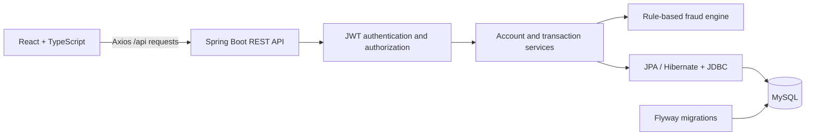

# LedgerGuard

**Transaction processing with explainable, rule-based fraud detection.**

LedgerGuard is a full-stack portfolio application for managing accounts, transferring funds, and reviewing suspicious activity. Customers can track their balances and transaction history, while administrators can monitor activity across the ledger and inspect the reasons behind each fraud decision.

The project demonstrates idempotent payments, password-confirmed authorization, administrator fraud overrides, an append-only audit trail, revocable sessions, and a React interface backed by real APIs. It is a development banking simulation; deposits and withdrawals do not connect to external payment networks.

## Features

| Area | Capabilities |
| --- | --- |
| Authentication | BCrypt passwords, session-specific JWTs, password change, session list/revocation, and server-side logout |
| Accounts | Checking and savings accounts, zero opening balance in the UI, and balances grouped by currency |
| Money movement | Deposits, withdrawals, and same-currency transfers with ownership, account status, and balance checks |
| Transaction history | Incoming and outgoing activity, type/status/risk/date filters, server-side pagination, and transaction details |
| Fraud analysis | Risk scores, triggered rules, decision explanations, and persisted blocked attempts |
| Administration | Metrics, monitoring, critical review queue, reasoned approval/rejection, and filtered audit trail |
| Payment reliability | User/operation-scoped idempotency keys, deterministic locks, and atomic ledger/audit/notification writes |
| Notifications | Private in-app updates, unread counts, mark-as-read, and transaction links |
| Beneficiaries | Save external account numbers, rename/remove destinations, and select them in transfers |
| Statements | Owned-account CSV/PDF downloads with verified opening/closing balances and UTC date ranges |
| Insights | Monthly completed inflows/outflows/net by account and currency, excluding own-account transfers from user summaries |

## Architecture

LedgerGuard uses a Spring Boot monolith with a separate React frontend.



### Technology stack

| Layer | Technologies |
| --- | --- |
| Backend | Java 21 compilation target, Spring Boot 3.4.3, Spring Security, Spring Data JPA, Bean Validation |
| Database | MySQL, Flyway migrations, Hibernate schema validation |
| Frontend | React, TypeScript, Vite, React Router, Axios |
| Verification | JUnit 5, Mockito, AssertJ, and a native Node.js API verification script |
| Local tooling | Maven Wrapper, npm lockfile, and Windows PowerShell startup scripts |

### Transaction consistency and access control

- Money uses Java `BigDecimal` and MySQL `DECIMAL(19,2)`. API responses serialize monetary values as decimal strings; the frontend sums balances using integer cents.
- Balance updates, transaction records, fraud analyses, ledger movements, audit events, notifications, and idempotency outcomes commit in one database transaction.
- Transfers acquire pessimistic account locks in ascending account-ID order to reduce deadlock risk during reciprocal transfers.
- Customers can access transactions involving their accounts, including incoming transfers. Unrelated transaction and fraud details return `404`.
- Public registration always creates a `CUSTOMER`. Admin endpoints require server-side `ADMIN` authorization.
- Flyway manages the schema. Hibernate validates mappings at startup instead of creating or modifying tables.

### Data model

| Entity | Purpose |
| --- | --- |
| `users` | Customer/admin identity and password hash |
| `accounts` | Account ownership, type, currency, status, balance, and version |
| `transactions` | Money movement or blocked attempt, participating accounts, status, and risk score |
| `fraud_analyses` | Original, confirmation-time, and administrator approval-time assessments |
| `fraud_rule_results` | Individual triggered rules, explanations, and score contributions |
| `confirmation_guards` | Per-user failed-password counters and temporary lockouts |
| `idempotency_records` | Request fingerprints and original public outcomes, scoped to user and operation |
| `audit_events` | Append-only actor, action, status transition, reason, transaction reference, and timestamp |
| `notifications` | User-owned, deduplicated transaction updates with read state |
| `beneficiaries` | User-owned friendly names for external account destinations |
| `account_baselines` / `ledger_movements` | Verified balance baseline and signed completed movements |
| `user_sessions` | Session identity, lifetime, revocation, and available request metadata; no raw JWTs |

See the [initial schema migration](backend/src/main/resources/db/migration/V1__initial_schema.sql) for foreign keys, indexes, and column definitions.

## Fraud detection

Withdrawals and transfers are evaluated by a deterministic rule engine. Deposits receive a low-risk approval without running the outgoing-transaction rules.

| Rule | Default trigger | Score |
| --- | --- | --- |
| High value | Amount is at least 10,000 | +45 |
| Unusual amount | Amount exceeds 3 times the user's average completed transaction amount | +35 |
| Rapid activity | User has initiated at least 3 transactions in the previous 5 minutes | +25 |
| Repeated recipient | At least 3 prior transfers from the same sender account to the same recipient in the previous 5 minutes | +35 |
| Balance risk | Remaining balance would be less than 10% of the outgoing amount | +20 |

Scores are capped at 100.

| Score | Risk level | Outcome |
| --- | --- | --- |
| 0-29 | LOW | Approve |
| 30-59 | MEDIUM | Await initiating user password confirmation; no funds move |
| 60-79 | HIGH | Await initiating user password confirmation; no funds move |
| 80-100 | CRITICAL | New outgoing attempt awaits admin review; no funds move or are reserved |

New MEDIUM/HIGH outgoing transactions display **Pending confirmation** and **Suspicious activity detected**. Completed suspicious transactions retain their warning. Blocked transactions display **Blocked**. Submission results, history, and details explain whether money moved and balances changed, and show the reasons stored with the fraud analysis. Risk level and score provide supporting context. A flag indicates unusual activity, not proof of fraud. New critical attempts display **Awaiting admin review**. Historical `BLOCKED` records remain non-executable; a critical password-confirmation reassessment is also blocked and cannot be approved.

The engine evaluates stored transaction activity, including blocked attempts in activity counts. Its thresholds are configurable; it does not use machine learning. Implementation: [FraudDetectionService.java](backend/src/main/java/com/portfolio/fraud/fraud/FraudDetectionService.java).

## Getting started

The documented workflow uses native Windows and PowerShell.

### Prerequisites

- **JDK:** compilation target 21; the verified runtime is Java 25.0.1.
- **Node.js and npm:** verified with Node 24.20.0 and npm 11.19.0.
- **MySQL Server 8.4:** running locally on port 3306, with an administrative account available for initial setup.
- **Git:** to clone the repository.

Maven is supplied through the checked-in wrapper. Docker, WSL, and a global Maven installation are not required.

### 1. Clone the repository

```powershell
git clone https://github.com/gsathvik228/LedgerGuard.git
Set-Location LedgerGuard
```

Run the following setup commands from this repository root.

### 2. Create local configuration and provision the database

```powershell
powershell.exe -NoProfile -ExecutionPolicy Bypass -File .\scripts\init-local-env.ps1
powershell.exe -NoProfile -ExecutionPolicy Bypass -File .\scripts\setup-native-mysql.ps1
```

The first script generates a git-ignored `.env` with random application credentials. It preserves an existing file.

The database setup script prompts for the MySQL root password, creates `fraud_db` and `fraud_app@localhost`, grants access to that database, and verifies the application user's connection. It does not create application tables, delete data, or reset existing passwords. Flyway creates the tables when the backend starts.

If `fraud_app` already exists, configure its current password in `.env` before running setup. For a nondefault client installation, pass `-MySqlExe 'C:\path\to\mysql.exe'` to the setup script. Database provisioning is a one-time step.

### 3. Start the backend

```powershell
powershell.exe -NoProfile -ExecutionPolicy Bypass -File .\start-backend.ps1
```

The launcher loads the root `.env` and invokes the Maven Wrapper. Successful startup includes Flyway validation, Hibernate initialization, and `Started FraudApplication`.

### 4. Start the frontend

Open a second PowerShell terminal in the repository root:

```powershell
Set-Location frontend
npm.cmd ci
npm.cmd run dev
```

| Service | Local address |
| --- | --- |
| Application | http://127.0.0.1:5173 |
| Backend API | http://127.0.0.1:8080/api |
| Swagger UI | http://127.0.0.1:8080/swagger-ui/index.html |

Open the application and register a customer account. The API base address is not a landing page. Use Ctrl+C in each server terminal to stop it.

### Development admin account

To enable admin review locally, run from the repository root:

```powershell
powershell.exe -NoProfile -ExecutionPolicy Bypass -File .\scripts\init-dev-admin.ps1
powershell.exe -NoProfile -ExecutionPolicy Bypass -File .\start-backend.ps1 -Dev
```

Stop an already-running backend before starting it with `-Dev`. The initialization script writes generated credentials to the private `.env.development` file. Open that file locally to obtain the admin email and password.

Admin provisioning requires both the `dev` Spring profile and `DEV_ADMIN_ENABLED=true`. It preserves existing credentials and refuses to promote a customer with the same email. Omitting `-Dev` disables provisioning; it does not remove an existing admin account.

## Password-confirmed suspicious payments

LOW-risk outgoing transactions execute normally. MEDIUM/HIGH transactions are persisted as `PENDING_CONFIRMATION` with their original fraud reasons; no funds are moved or reserved. Only the initiating user can authorize with their current password or cancel, including when the recipient or another administrator can view the transaction.

- The default confirmation window is **5 minutes**. An expiry job runs every five seconds; authorization also checks the deadline before and after waiting for locks.
- Confirmation verifies the existing BCrypt password hash. Passwords are never recorded in the database, application logs, React state, or browser storage; the input is cleared when submitted.
- **5 failed attempts within 5 minutes** cause a **60-second per-user lockout**, shared across pending transactions and persisted in MySQL. Incorrect passwords return HTTP 400; an active lockout returns HTTP 429. Cancellation remains available during lockout.
- Confirmation locks the transaction first and account rows in ascending ID order. It rechecks ownership, account status, currencies, funds, and current fraud activity, excluding the pending transaction itself. The confirmation transaction uses READ_COMMITTED isolation to reassess committed activity after waiting for locks.
- A CRITICAL reassessment records `BLOCKED`; the password cannot override it. Other account/funds failures record `FAILED` with an explanation. Successful authorization applies both balances and final state atomically.
- Repeated confirmation/cancellation requests return the existing terminal outcome without executing again. Concurrent confirmation and cancellation are serialized by the transaction lock.
- The original fraud assessment remains unchanged. The fraud detail response includes a nullable `confirmation` assessment; transaction responses include `confirmationExpiresAt`, `resolvedAt`, `outcomeReason`, and viewer-specific `canConfirm`.
- Cancellation and expiry record `CANCELLED` or `EXPIRED` without moving funds. History includes these states; pending detail/submission views refresh terminal outcomes automatically.

The additive [V2 migration](backend/src/main/resources/db/migration/V2__pending_confirmations.sql) preserves existing records, including previously completed suspicious transactions. Password authorization explicitly accepts the warning; it is separate from the administrator review queue for new critical attempts.

## Review lifecycle and payment retries

| Initial decision or action | Recorded outcome | Balance effect |
| --- | --- | --- |
| LOW outgoing / deposit | `COMPLETED` | Apply once |
| MEDIUM/HIGH outgoing | `PENDING_CONFIRMATION` | None; no reservation |
| New CRITICAL outgoing | `AWAITING_REVIEW` | None; no reservation |
| Correct password, checks pass | `COMPLETED` | Apply once |
| Password reassessment becomes CRITICAL | `BLOCKED` | None; cannot be overridden |
| Admin approval, account checks pass | `COMPLETED` with `ADMIN_OVERRIDE` assessment | Apply once, even if reassessment remains critical |
| Admin rejection | `REJECTED` | None |
| Account/currency/funds checks fail at confirmation or approval | `FAILED` | None |
| Initiator cancels either pending state | `CANCELLED` | None |
| Either authorization deadline passes | `EXPIRED` | None |

Administrators must provide a reason (1?180 characters). Approval locks the transaction, then accounts in ascending ID order; rechecks ownership, active status, matching currencies and funds; and runs the unchanged fraud engine excluding the current attempt. The separate assessment records an explicit override, never a disabled rule. Conflicting decisions return HTTP 409. The default review lifetime is 24 hours; the scheduler and decision endpoints enforce expiry. No terminal state returns to a pending state. Customers can cancel their own requests while pending.

Every deposit, withdrawal, transfer, confirmation, cancellation, and admin decision requires an `Idempotency-Key` header: 16?80 letters, digits, hyphens or underscores (a UUID works). Keys are scoped to the authenticated user and operation, including the transaction ID for decisions. Reuse a key with identical content to replay the original outcome, including domain rejection errors. Different content returns HTTP 409. Authentication and request-shape validation occur before this protocol. Concurrent retries serialize on a database primary key; financial changes and the stored response commit together. Unexpected server failures roll back the whole operation.

The frontend retains a submission key for transport/5xx retries and creates a new key after a definitive outcome or changed input. Keys live only in component memory; after a browser reload, check history before submitting again. Replayed creation responses intentionally show their original pending state; fetch transaction details for its current state. Request fingerprints use HMAC; passwords and raw request bodies are never stored in idempotency records.

## Statements, insights, and history coverage

The additive [V3 migration](backend/src/main/resources/db/migration/V3__ledger_workspace.sql) snapshots each existing account's current balance. New accounts record their actual opening balance. Every subsequent completed transaction records signed account movements atomically with the balance change. Statements calculate opening and closing balances from that baseline and movements at **settlement time**, including payments authorized later than creation. Pending, blocked, failed, rejected, cancelled and expired attempts do not contribute.

Legacy initial balances and exact historical settlement times cannot be proven from the old schema. Requests starting before an account's verified baseline date return HTTP 409 instead of inventing earlier balances. On the baseline date, the statement explicitly begins at the recorded baseline instant. CSV and PDF include this coverage and provenance. Only account owners can download statements; administrators have no exception. CSV text fields neutralize spreadsheet formulas. The PDF is paginated text using built-in Helvetica; unsupported non-Latin glyphs are replaced with question marks. CSV preserves Unicode.

Insights aggregate completed signed movements by UTC month and currency from each account's coverage start. Account-level views include incoming/outgoing internal transfers; user-level views exclude transfers between the user's own accounts. Currencies are never added together. Pre-baseline activity is excluded and coverage is shown. No spending categories are inferred.

## Sessions and security settings

Every newly issued JWT carries a random session ID. Protected requests require both a valid signed JWT and an unexpired, nonrevoked server session. Existing tokens without a session ID are rejected with HTTP 401 after migration: sign in again. No raw token is stored server-side. Sessions show creation, last activity, expiry, user-agent and direct network address; this metadata does not establish a verified device identity.

Logout revokes the current session. Users can revoke an individual owned session or all other sessions. Password change checks the current BCrypt password, validates the new password (8+ characters, at most 72 UTF-8 bytes, different from the current password), and revokes all sessions atomically. Fresh login is required. Password-change failures share the persistent per-user password guard with confirmations. The frontend clears password inputs on submission and never stores them in browser storage. Already-running requests may finish when a session is revoked; subsequent requests are denied.

## Configuration

| Variable | Purpose |
| --- | --- |
| `MYSQL_DATABASE` | Database name; local setup uses `fraud_db` |
| `MYSQL_USER` | Application database user; local setup uses `fraud_app` |
| `MYSQL_PASSWORD` | Required database password |
| `JWT_SECRET` | Required JWT signing secret; generated by the initialization script |
| `JWT_EXPIRATION_MS` | Token lifetime; default `3600000` (one hour) |
| `DB_URL` | Optional JDBC URL override |
| `REVIEW_TTL_SECONDS` | Admin review lifetime; default `86400` (24 hours) |
| `CONFIRMATION_TTL_SECONDS` | Pending authorization lifetime; default `300` |
| `CONFIRMATION_MAX_FAILURES` | Failed attempts before lockout; default `5` |
| `CONFIRMATION_ATTEMPT_WINDOW_SECONDS` | Failed-attempt window; default `300` |
| `CONFIRMATION_LOCK_SECONDS` | Per-user lockout duration; default `60` |
| `FRAUD_HIGH_VALUE` | High-value threshold; default `10000` |
| `FRAUD_RAPID_WINDOW_MINUTES` | Activity window; default `5` |
| `FRAUD_RAPID_COUNT` / `FRAUD_REPEAT_COUNT` | Activity-count thresholds; both default to `3` |
| `FRAUD_HISTORICAL_MULTIPLIER` | Unusual-amount multiplier; default `3` |

See [.env.example](.env.example) and [application.yml](backend/src/main/resources/application.yml).

The startup script resolves configuration relative to the repository, regardless of the terminal's working directory. Existing process environment variables take precedence over file values. Use literal `NAME=value` entries with optional matching quotes and separate comment lines.

The wrapper honors `JAVA_HOME` if set; otherwise it uses Java on `PATH`. Direct Maven startup does not load `.env`, so use the launcher for local execution.

The frontend sends relative `/api` requests through Vite's proxy to port 8080. Only `VITE_`-prefixed environment variables are exposed to browser code; credentials must never use that prefix. Production hosting would require its own API routing.

## API overview

All routes below use the `/api` prefix. Protected requests require an `Authorization: Bearer <token>` header. Swagger UI provides the full request and response schemas.

| Method | Route | Description |
| --- | --- | --- |
| POST | `/auth/register` | Register a customer |
| POST | `/auth/login` | Obtain a JWT and profile |
| GET | `/me` | Retrieve the authenticated profile |
| GET / POST | `/accounts` | List own accounts / create an account |
| POST | `/transactions/deposit` | Deposit into an owned account |
| POST | `/transactions/withdraw` | Withdraw from an owned account |
| POST | `/transactions/transfer` | Transfer between same-currency accounts |
| POST | `/transactions/{id}/confirm` | Initiator only; JSON body `{ "password": "..." }` |
| POST | `/transactions/{id}/cancel` | Initiator only; no password required |
| GET | `/transactions` | List participating transactions |
| GET | `/transactions/{id}` | View transaction details |
| GET | `/transactions/{id}/fraud` | View the fraud decision and rules |
| GET | `/admin/dashboard` | Retrieve counts and volume by currency |
| GET | `/admin/transactions` | Monitor all transactions |
| GET | `/admin/fraud` | Monitor HIGH and CRITICAL transactions |
| GET | `/admin/transactions/{id}` | Review a transaction as an admin |
| GET | `/admin/transactions/{id}/fraud` | Review its fraud analysis |
| GET | `/admin/reviews` | Paginated pending critical review queue |
| POST | `/admin/reviews/{id}/decision` | `{ "approve": true, "reason": "..." }`, or false to reject |
| GET | `/admin/audit` | Paginated audit; filter actorId, transactionId, action, from, to |
| GET | `/transactions/{id}/timeline` | Customer-safe participating-transaction audit timeline |
| GET | `/notifications` / `/notifications/unread` | Paginated owned notifications / unread count |
| POST | `/notifications/{id}/read` | Mark an owned notification as read |
| GET / POST | `/beneficiaries` | List / save accountNumber and friendlyName |
| PATCH / DELETE | `/beneficiaries/{id}` | Rename via friendlyName / remove an owned beneficiary |
| GET | `/statements/coverage` | Verified history start for each owned account |
| GET | `/accounts/{id}/statement` | from/to UTC dates; format=json, csv, or pdf |
| GET | `/insights` | from/to UTC dates; optional accountId and currency |
| GET | `/security/sessions` | List active owned sessions |
| DELETE | `/security/sessions/{id}` | Revoke an owned session |
| POST | `/security/sessions/revoke-others` | Revoke other sessions |
| POST | `/security/logout` | Revoke current session |
| POST | `/security/password` | currentPassword/newPassword; revokes all sessions |

Transaction lists accept `type`, `status`, `risk`, `from`, `to`, `page`, and `size`. Dates are ISO-8601 instants; page numbers start at zero and page sizes range from 1 to 100.

## Testing

From the repository root:

```powershell
# Unit tests and executable JAR
.\backend\mvnw.cmd clean verify

# TypeScript validation and production assets
npm.cmd run build --prefix frontend

# Integration checks against the running application
node .\scripts\verify-api.mjs

# Suspicious outcome communication and persisted rule checks
node .\scripts\verify-outcomes.mjs

# Authorization, concurrency, rate limiting, reassessment, and expiry
node .\scripts\verify-confirmations.mjs

# All eight workspace additions, including review/session/report contracts
node .\scripts\verify-workspace.mjs
```

The confirmation verifier creates isolated development records and exercises real concurrent requests. It waits for the configured deadline to test expiry. For a shorter run, set `$env:CONFIRMATION_TTL_SECONDS = "20"` in the backend terminal before starting it; remove that variable and restart afterward to restore the five-minute default.

The outcome verifier creates a new development customer and checks MEDIUM/HIGH completed transfers and a CRITICAL review request against the real API. It verifies balance effects and history persistence, then renders the shared warning component with those stored analyses to check messages, reasons, and loading/error states. It uses existing frontend dependencies and default fraud thresholds. These component checks do not replace browser interaction testing.

The API verifier requires the backend running with `-Dev`, a generated admin configuration, the frontend, and default fraud thresholds. Each run creates two new test customers and development transactions. It preserves existing records and stores generated logins and results under git-ignored `.local/`.

### Verification coverage

Verification on **2026-10-11** passed:

- **31 backend tests:** fraud rules, confirmation and review lifecycles, deterministic locking, balances, closed-state protection, access controls, CSV escaping, and multipage PDF structure.
- **12 workspace API verification groups:** concurrent idempotency and error replay, review approvals/rejection/races/expiry, audit/notification ownership, beneficiaries, CSV/PDF reconciliation, session revocation/password changes, and currency-separated insights.
- **9 live confirmation verification groups:** pending balance protection, wrong/unauthorized passwords, persisted per-user throttling, cancellation, duplicate/concurrent authorization, insufficient funds, CRITICAL reassessment, and scheduled expiry.
- **15 existing live API verification groups:** authentication and authorization, account operations, incoming-transfer visibility, rejected operations with unchanged balances, fraud persistence, filters/pagination, admin monitoring, reciprocal concurrent transfers, and the Vite proxy.
- Native MySQL connectivity, Flyway validation, Hibernate schema validation, and the frontend production build.

Browser interaction and visual layout are **unverified**: no browser automation is installed. Manual checklist: retry a payment after a connection failure; authorize/cancel a warning; approve/reject a critical attempt as admin; follow a notification and mark it read; save/rename/select/remove a beneficiary; preview/download a statement; filter insights; revoke another session/change password; and check navigation at a narrow viewport. API and server-rendered component checks do not replace these browser interactions.

For the workspace expiry verifier, stop the backend and use a **temporary test terminal**:

```powershell
Set-Location C:\Projects\Full-Stack\transaction-fraud-system
$env:CONFIRMATION_TTL_SECONDS = "30"
$env:REVIEW_TTL_SECONDS = "30"
powershell.exe -NoProfile -ExecutionPolicy Bypass -File .\start-backend.ps1 -Dev
```

Run `node .\scripts\verify-workspace.mjs` in a second terminal. Afterwards stop the backend, remove the temporary overrides, and restart:

```powershell
Remove-Item Env:CONFIRMATION_TTL_SECONDS -ErrorAction SilentlyContinue
Remove-Item Env:REVIEW_TTL_SECONDS -ErrorAction SilentlyContinue
powershell.exe -NoProfile -ExecutionPolicy Bypass -File .\start-backend.ps1 -Dev
```

Verification creates isolated development accounts and transactions; it never resets data. Private credentials/reports stay in ignored `.local/`. Stop the old backend before applying migrations so no old application instance writes outside the new ledger workflow.

## Demo walkthrough

1. Register two customers and create a USD account for each.
2. Sign in as the first customer. Deposit USD 30,000, withdraw USD 50, and transfer USD 100.25 to the second account using its account ID.
3. Within five minutes, attempt another transfer of USD 29,000. With default thresholds, high value (+45), rapid activity (+25), and balance risk (+20) produce a **90/100 CRITICAL** score. The attempt is recorded as **AWAITING_REVIEW**, and neither balance changes.
4. Open its transaction details to inspect the decision and triggered rules.
5. Sign in as the development admin, open **Review queue**, inspect the reasons and timeline, then approve with an explicit reason or reject. Approval moves funds once; rejection leaves balances unchanged.
6. Sign in as the recipient, follow the incoming-transfer notification, and mark it read. Save the other account as a beneficiary for a future transfer.
7. Open **Statements** for today to reconcile completed movements; download CSV/PDF. Open **Insights** to compare inflows/outflows by currency.
8. Open **Security settings**, revoke another session, then change the password and verify that a fresh sign-in is required.

Use fresh accounts for the reproducible score above. Additional activity or customized thresholds can change the result.

## Repository structure

```text
backend/
  src/main/java/com/portfolio/fraud/
    controller/       REST endpoints
    dto/              Validated request and response contracts
    entity/           JPA data model
    repository/       Database queries and account locks
    service/          Account, authentication, and transaction workflows
    fraud/            Fraud rules and risk scoring
    security/         JWT authorization and development admin setup
  src/main/resources/
    db/migration/     Flyway schema migrations
    application.yml   Backend configuration
  src/test/           Backend tests
frontend/
  src/                Pages, API client, authentication, and UI utilities
  src.tsx             Application entry point and routing
  style.css           Responsive styling
scripts/              Environment, database, admin, and API verification tools
start-backend.ps1      Windows backend launcher
```

## Scope and limitations

LedgerGuard is intended for local development and portfolio review. Deposits and opening balances are simulated; no external funds are verified. Transfers require matching currencies, and the fraud engine does not normalize historical amounts across currencies. Admin volume metrics represent gross transaction activity, not account balances.

Production use would require payment integration, deployment hardening, review of browser token storage (currently localStorage), login/registration abuse controls, operational monitoring, and broader browser/security testing. Audit events are append-only through the application; they are not tamper-proof against a database administrator. Idempotency and audit data currently have no retention purge. In-app notifications use polling, with no external delivery service. Local secrets, generated demo credentials, logs, dependencies, and build outputs are excluded from Git.

## Scheduled payments

One-time scheduled transfers are available from **Scheduled payments**. Creating a schedule is the user's initial authorization. LOW-risk transfers execute automatically when due, including after sign-out. MEDIUM/HIGH-risk transfers enter the existing password confirmation workflow; CRITICAL-risk transfers enter admin review. Passwords and JWTs are never saved with schedules. The existing confirmation/review expiry rules apply from processing time.

Schedules reserve no funds. Account ownership, status, currency and available funds are rechecked at execution. Insufficient funds or incompatible/inactive accounts produce a terminal FAILED schedule; adding funds later does not retry it. Unexpected infrastructure errors roll back the whole attempt and are retried by the worker. Due schedules are processed in batches of up to 100, normally every five seconds. Overdue schedules are picked up after restart.

The worker locks the schedule row before calling the existing transfer service. The resulting transaction, balance changes, ledger, fraud decision, audit records and schedule link commit together. A second worker or retry sees the committed outcome and cannot transfer again. Cancellation takes the same schedule lock: it succeeds before processing, or checks the resulting transaction after processing. A completed transfer cannot be cancelled. Pending password confirmation and admin review can be cancelled through the scheduled-payments page or transaction details.

The API stores times as UTC instants. The form accepts and displays the browser's local timezone. A schedule's SCHEDULED/CANCELLED/FAILED state describes its lifecycle; PROCESSED means a linked transaction was created. The UI displays that transaction's current status.

| Method | Route | Purpose |
| --- | --- | --- |
| POST | /api/scheduled-payments | Create; requires Idempotency-Key |
| GET | /api/scheduled-payments?page=0&size=20 | Owned schedules; size 1–100 |
| GET | /api/scheduled-payments/{id} | Owned schedule and current linked transaction |
| POST | /api/scheduled-payments/{id}/cancel | Cancel unprocessed schedule or eligible pending transaction |

Creation body: senderAccountId, recipientAccountId, amount (decimal string), optional description, executeAt (ISO-8601 instant). Reuse the same Idempotency-Key and body after a transport error. Reuse with different content returns 409. Scheduling does not require enough funds at creation. Recurrence and editing are outside this feature.

### Run locally from the isolated worktree

In PowerShell:

    Set-Location C:\Users\user\.codex\worktrees\scheduled-payments\LedgerGuard
    powershell.exe -NoProfile -ExecutionPolicy Bypass -File .\scripts\init-local-env.ps1
    powershell.exe -NoProfile -ExecutionPolicy Bypass -File .\scripts\setup-native-mysql.ps1
    powershell.exe -NoProfile -ExecutionPolicy Bypass -File .\scripts\init-dev-admin.ps1
    powershell.exe -NoProfile -ExecutionPolicy Bypass -File .\start-backend.ps1 -Dev

The setup script prompts for a MySQL administrative password. If the application user already exists, set its existing password in the ignored .env first. Use a separate development database for review; do not point a second application at a database still used by an older backend. Flyway applies V4 automatically. The temporary test MySQL instance used during implementation is separate from the normal database on port 3306.

In a second terminal:

    Set-Location C:\Users\user\.codex\worktrees\scheduled-payments\LedgerGuard
    npm.cmd ci --prefix frontend
    npm.cmd run dev --prefix frontend

Open http://127.0.0.1:5173. Register two customers and create USD accounts. Fund the sender through Move money. Schedule a small transfer one minute ahead, then verify one debit, one credit and one history record. Try cancellation before due time. Schedule another payment, stop the backend before it is due, and restart after its due time; verify it processes once.

For repeatable fraud cases, use fresh sender accounts funded with USD 30,000 and default fraud settings:

- LOW: schedule USD 10; it should complete automatically.
- MEDIUM: schedule USD 10,000; it should require password confirmation with unchanged balances until confirmed.
- HIGH: schedule USD 29,000; high value plus low remaining balance should require password confirmation.
- CRITICAL: make three USD 1 withdrawals immediately before the USD 29,000 scheduled payment becomes due; it should enter admin review. Sign in as the development admin and approve or reject.
- Insufficient funds: schedule from an account with no funds; it should fail when due. Funding it afterwards must not execute the failed payment.

Keep the browser open when testing password confirmation; its default deadline is five minutes. Existing activity can change fraud scores. Verify pending cancellation, another user's denied access, notification/history links, sign-out/sign-in, and the page at a narrow viewport.

### Automated verification

    .\backend\mvnw.cmd test
    npm.cmd run build --prefix frontend

The MySQL tests are opt-in and otherwise skipped. Provision a dedicated database named ledgerguard_schedule_test and grant a test user access. The tests add disposable records; they do not truncate tables. In a temporary PowerShell terminal, set:

    $env:SCHEDULE_TEST_DB_URL='jdbc:mysql://127.0.0.1:3306/ledgerguard_schedule_test?serverTimezone=UTC'
    $env:SCHEDULE_TEST_DB_USER='your_test_user'
    $env:SCHEDULE_TEST_DB_PASSWORD=Read-Host 'Test database password'
    .\backend\mvnw.cmd test

The database name is enforced by the test's enablement condition. Flyway initializes its schema. These tests cover simultaneous workers, concurrent creation retries, cancellation races, rollback followed by rediscovery, execution-time funds/status checks, password confirmation, admin review, login/JWT protection and transaction visibility. Rollback/rediscovery checks model loss of an uncommitted attempt; use the manual stop/restart check above for an actual process restart. Test passwords are fixed disposable fixture values and are stored only as BCrypt user hashes, never in schedules.

Normal existing live checks remain available under scripts/verify-api.mjs, verify-confirmations.mjs, verify-outcomes.mjs and verify-workspace.mjs; see their prerequisites above. Worker polling may be configured with the Spring property app.scheduled-payments.poll-ms (default 5000); app.scheduled-payments.initial-delay-ms defaults to 0 and is extended only in database tests to allow deterministic execution.
