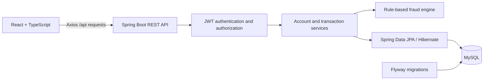

# LedgerGuard

**Transaction processing with explainable, rule-based fraud detection.**

LedgerGuard is a full-stack portfolio application for managing accounts, transferring funds, and reviewing suspicious activity. Customers can track their balances and transaction history, while administrators can monitor activity across the ledger and inspect the reasons behind each fraud decision.

The project demonstrates password-confirmed authorization, transactional consistency, role-based authorization, concurrent account updates, and a React interface backed by real APIs. It is a development banking simulation; deposits and withdrawals do not connect to external payment networks.

## Features

| Area | Capabilities |
| --- | --- |
| Authentication | Registration, BCrypt password hashing, expiring JWTs, persistent sign-in, logout, and protected routes |
| Accounts | Checking and savings accounts, zero opening balance in the UI, and balances grouped by currency |
| Money movement | Deposits, withdrawals, and same-currency transfers with ownership, account status, and balance checks |
| Transaction history | Incoming and outgoing activity, type/status/risk/date filters, server-side pagination, and transaction details |
| Fraud analysis | Risk scores, triggered rules, decision explanations, and persisted blocked attempts |
| Administration | Activity metrics, charts, paginated transaction monitoring, and high/critical-risk review |

## Architecture

LedgerGuard uses a Spring Boot monolith with a separate React frontend.



### Technology stack

| Layer | Technologies |
| --- | --- |
| Backend | Java 21 compilation target, Spring Boot 3.4.3, Spring Security, Spring Data JPA, Bean Validation |
| Database | MySQL, Flyway migrations, Hibernate schema validation |
| Frontend | React, TypeScript, Vite, React Router, Axios |
| Verification | JUnit 5, Mockito, AssertJ, and a native Node.js API verification script |
| Local tooling | Maven Wrapper, npm lockfile, and Windows PowerShell startup scripts |

### Transaction consistency and access control

- Money uses Java `BigDecimal` and MySQL `DECIMAL(19,2)`. API responses serialize monetary values as decimal strings; the frontend sums balances using integer cents.
- Balance updates, transaction records, and fraud analyses execute within a database transaction.
- Transfers acquire pessimistic account locks in ascending account-ID order to reduce deadlock risk during reciprocal transfers.
- Customers can access transactions involving their accounts, including incoming transfers. Unrelated transaction and fraud details return `404`.
- Public registration always creates a `CUSTOMER`. Admin endpoints require server-side `ADMIN` authorization.
- Flyway manages the schema. Hibernate validates mappings at startup instead of creating or modifying tables.

### Data model

| Entity | Purpose |
| --- | --- |
| `users` | Customer/admin identity and password hash |
| `accounts` | Account ownership, type, currency, status, balance, and version |
| `transactions` | Money movement or blocked attempt, participating accounts, status, and risk score |
| `fraud_analyses` | Immutable original assessment and a separate confirmation-time assessment |
| `fraud_rule_results` | Individual triggered rules, explanations, and score contributions |
| `confirmation_guards` | Per-user failed-password counters and temporary confirmation lockouts |

See the [initial schema migration](backend/src/main/resources/db/migration/V1__initial_schema.sql) for foreign keys, indexes, and column definitions.

## Fraud detection

Withdrawals and transfers are evaluated by a deterministic rule engine. Deposits receive a low-risk approval without running the outgoing-transaction rules.

| Rule | Default trigger | Score |
| --- | --- | --- |
| High value | Amount is at least 10,000 | +45 |
| Unusual amount | Amount exceeds 3 times the user's average completed transaction amount | +35 |
| Rapid activity | User has initiated at least 3 transactions in the previous 5 minutes | +25 |
| Repeated recipient | At least 3 prior transfers from the same sender account to the same recipient in the previous 5 minutes | +35 |
| Balance risk | Remaining balance would be less than 10% of the outgoing amount | +20 |

Scores are capped at 100.

| Score | Risk level | Outcome |
| --- | --- | --- |
| 0-29 | LOW | Approve |
| 30-59 | MEDIUM | Await initiating user password confirmation; no funds move |
| 60-79 | HIGH | Await initiating user password confirmation; no funds move |
| 80-100 | CRITICAL | Block; persist the attempt and reasons without changing balances |

New MEDIUM/HIGH outgoing transactions display **Pending confirmation** and **Suspicious activity detected**. Completed suspicious transactions retain their warning. Blocked transactions display **Blocked**. Submission results, history, and details explain whether money moved and balances changed, and show the reasons stored with the fraud analysis. Risk level and score provide supporting context. A flag indicates unusual activity, not proof of fraud; it does not initiate a human review workflow.

The engine evaluates stored transaction activity, including blocked attempts in activity counts. Its thresholds are configurable; it does not use machine learning. Implementation: [FraudDetectionService.java](backend/src/main/java/com/portfolio/fraud/fraud/FraudDetectionService.java).

## Getting started

The documented workflow uses native Windows and PowerShell.

### Prerequisites

- **JDK:** compilation target 21; the verified runtime is Java 25.0.1.
- **Node.js and npm:** verified with Node 24.20.0 and npm 11.19.0.
- **MySQL Server 8.4:** running locally on port 3306, with an administrative account available for initial setup.
- **Git:** to clone the repository.

Maven is supplied through the checked-in wrapper. Docker, WSL, and a global Maven installation are not required.

### 1. Clone the repository

```powershell
git clone https://github.com/gsathvik228/LedgerGuard.git
Set-Location LedgerGuard
```

Run the following setup commands from this repository root.

### 2. Create local configuration and provision the database

```powershell
powershell.exe -NoProfile -ExecutionPolicy Bypass -File .\scripts\init-local-env.ps1
powershell.exe -NoProfile -ExecutionPolicy Bypass -File .\scripts\setup-native-mysql.ps1
```

The first script generates a git-ignored `.env` with random application credentials. It preserves an existing file.

The database setup script prompts for the MySQL root password, creates `fraud_db` and `fraud_app@localhost`, grants access to that database, and verifies the application user's connection. It does not create application tables, delete data, or reset existing passwords. Flyway creates the tables when the backend starts.

If `fraud_app` already exists, configure its current password in `.env` before running setup. For a nondefault client installation, pass `-MySqlExe 'C:\path\to\mysql.exe'` to the setup script. Database provisioning is a one-time step.

### 3. Start the backend

```powershell
powershell.exe -NoProfile -ExecutionPolicy Bypass -File .\start-backend.ps1
```

The launcher loads the root `.env` and invokes the Maven Wrapper. Successful startup includes Flyway validation, Hibernate initialization, and `Started FraudApplication`.

### 4. Start the frontend

Open a second PowerShell terminal in the repository root:

```powershell
Set-Location frontend
npm.cmd ci
npm.cmd run dev
```

| Service | Local address |
| --- | --- |
| Application | http://127.0.0.1:5173 |
| Backend API | http://127.0.0.1:8080/api |
| Swagger UI | http://127.0.0.1:8080/swagger-ui/index.html |

Open the application and register a customer account. The API base address is not a landing page. Use Ctrl+C in each server terminal to stop it.

### Development admin account

To enable admin review locally, run from the repository root:

```powershell
powershell.exe -NoProfile -ExecutionPolicy Bypass -File .\scripts\init-dev-admin.ps1
powershell.exe -NoProfile -ExecutionPolicy Bypass -File .\start-backend.ps1 -Dev
```

Stop an already-running backend before starting it with `-Dev`. The initialization script writes generated credentials to the private `.env.development` file. Open that file locally to obtain the admin email and password.

Admin provisioning requires both the `dev` Spring profile and `DEV_ADMIN_ENABLED=true`. It preserves existing credentials and refuses to promote a customer with the same email. Omitting `-Dev` disables provisioning; it does not remove an existing admin account.

## Password-confirmed suspicious payments

LOW-risk outgoing transactions execute normally. MEDIUM/HIGH transactions are persisted as `PENDING_CONFIRMATION` with their original fraud reasons; no funds are moved or reserved. Only the initiating user can authorize with their current password or cancel, including when the recipient or another administrator can view the transaction.

- The default confirmation window is **5 minutes**. An expiry job runs every five seconds; authorization also checks the deadline before and after waiting for locks.
- Confirmation verifies the existing BCrypt password hash. Passwords are never recorded in the database, application logs, React state, or browser storage; the input is cleared when submitted.
- **5 failed attempts within 5 minutes** cause a **60-second per-user lockout**, shared across pending transactions and persisted in MySQL. Incorrect passwords return HTTP 400; an active lockout returns HTTP 429. Cancellation remains available during lockout.
- Confirmation locks the transaction first and account rows in ascending ID order. It rechecks ownership, account status, currencies, funds, and current fraud activity, excluding the pending transaction itself. The confirmation transaction uses READ_COMMITTED isolation to reassess committed activity after waiting for locks.
- A CRITICAL reassessment records `BLOCKED`; the password cannot override it. Other account/funds failures record `FAILED` with an explanation. Successful authorization applies both balances and final state atomically.
- Repeated confirmation/cancellation requests return the existing terminal outcome without executing again. Concurrent confirmation and cancellation are serialized by the transaction lock.
- The original fraud assessment remains unchanged. The fraud detail response includes a nullable `confirmation` assessment; transaction responses include `confirmationExpiresAt`, `resolvedAt`, `outcomeReason`, and viewer-specific `canConfirm`.
- Cancellation and expiry record `CANCELLED` or `EXPIRED` without moving funds. History includes these states; pending detail/submission views refresh terminal outcomes automatically.

The additive [V2 migration](backend/src/main/resources/db/migration/V2__pending_confirmations.sql) preserves existing records, including previously completed suspicious transactions. Authorizing a payment explicitly accepts the warning; it does not request a human review.

## Configuration

| Variable | Purpose |
| --- | --- |
| `MYSQL_DATABASE` | Database name; local setup uses `fraud_db` |
| `MYSQL_USER` | Application database user; local setup uses `fraud_app` |
| `MYSQL_PASSWORD` | Required database password |
| `JWT_SECRET` | Required JWT signing secret; generated by the initialization script |
| `JWT_EXPIRATION_MS` | Token lifetime; default `3600000` (one hour) |
| `DB_URL` | Optional JDBC URL override |
| `CONFIRMATION_TTL_SECONDS` | Pending authorization lifetime; default `300` |
| `CONFIRMATION_MAX_FAILURES` | Failed attempts before lockout; default `5` |
| `CONFIRMATION_ATTEMPT_WINDOW_SECONDS` | Failed-attempt window; default `300` |
| `CONFIRMATION_LOCK_SECONDS` | Per-user lockout duration; default `60` |
| `FRAUD_HIGH_VALUE` | High-value threshold; default `10000` |
| `FRAUD_RAPID_WINDOW_MINUTES` | Activity window; default `5` |
| `FRAUD_RAPID_COUNT` / `FRAUD_REPEAT_COUNT` | Activity-count thresholds; both default to `3` |
| `FRAUD_HISTORICAL_MULTIPLIER` | Unusual-amount multiplier; default `3` |

See [.env.example](.env.example) and [application.yml](backend/src/main/resources/application.yml).

The startup script resolves configuration relative to the repository, regardless of the terminal's working directory. Existing process environment variables take precedence over file values. Use literal `NAME=value` entries with optional matching quotes and separate comment lines.

The wrapper honors `JAVA_HOME` if set; otherwise it uses Java on `PATH`. Direct Maven startup does not load `.env`, so use the launcher for local execution.

The frontend sends relative `/api` requests through Vite's proxy to port 8080. Only `VITE_`-prefixed environment variables are exposed to browser code; credentials must never use that prefix. Production hosting would require its own API routing.

## API overview

All routes below use the `/api` prefix. Protected requests require an `Authorization: Bearer <token>` header. Swagger UI provides the full request and response schemas.

| Method | Route | Description |
| --- | --- | --- |
| POST | `/auth/register` | Register a customer |
| POST | `/auth/login` | Obtain a JWT and profile |
| GET | `/me` | Retrieve the authenticated profile |
| GET / POST | `/accounts` | List own accounts / create an account |
| POST | `/transactions/deposit` | Deposit into an owned account |
| POST | `/transactions/withdraw` | Withdraw from an owned account |
| POST | `/transactions/transfer` | Transfer between same-currency accounts |
| POST | `/transactions/{id}/confirm` | Initiator only; JSON body `{ "password": "..." }` |
| POST | `/transactions/{id}/cancel` | Initiator only; no password required |
| GET | `/transactions` | List participating transactions |
| GET | `/transactions/{id}` | View transaction details |
| GET | `/transactions/{id}/fraud` | View the fraud decision and rules |
| GET | `/admin/dashboard` | Retrieve counts and volume by currency |
| GET | `/admin/transactions` | Monitor all transactions |
| GET | `/admin/fraud` | Monitor HIGH and CRITICAL transactions |
| GET | `/admin/transactions/{id}` | Review a transaction as an admin |
| GET | `/admin/transactions/{id}/fraud` | Review its fraud analysis |

Transaction lists accept `type`, `status`, `risk`, `from`, `to`, `page`, and `size`. Dates are ISO-8601 instants; page numbers start at zero and page sizes range from 1 to 100.

## Testing

From the repository root:

```powershell
# Unit tests and executable JAR
.\backend\mvnw.cmd clean verify

# TypeScript validation and production assets
npm.cmd run build --prefix frontend

# Integration checks against the running application
node .\scripts\verify-api.mjs

# Suspicious outcome communication and persisted rule checks
node .\scripts\verify-outcomes.mjs

# Authorization, concurrency, rate limiting, reassessment, and expiry
node .\scripts\verify-confirmations.mjs
```

The confirmation verifier creates isolated development records and exercises real concurrent requests. It waits for the configured deadline to test expiry. For a shorter run, set `$env:CONFIRMATION_TTL_SECONDS = "20"` in the backend terminal before starting it; remove that variable and restart afterward to restore the five-minute default.

The outcome verifier creates a new development customer and checks MEDIUM/HIGH completed transfers and a CRITICAL blocked transfer against the real API. It verifies balance effects and history persistence, then renders the shared warning component with those stored analyses to check messages, reasons, and loading/error states. It uses existing frontend dependencies and default fraud thresholds. These component checks do not replace browser interaction testing.

The API verifier requires the backend running with `-Dev`, a generated admin configuration, the frontend, and default fraud thresholds. Each run creates two new test customers and development transactions. It preserves existing records and stores generated logins and results under git-ignored `.local/`.

### Verification coverage

The last recorded verification on **2026-10-11** passed:

- **21 backend tests:** fraud rules, deterministic locking, exact balance changes, critical blocking, currency/ownership/funds/status checks, recipient access, and stored account types.
- **9 live confirmation verification groups:** pending balance protection, wrong/unauthorized passwords, persisted per-user throttling, cancellation, duplicate/concurrent authorization, insufficient funds, CRITICAL reassessment, and scheduled expiry.
- **15 existing live API verification groups:** authentication and authorization, account operations, incoming-transfer visibility, rejected operations with unchanged balances, fraud persistence, filters/pagination, admin monitoring, reciprocal concurrent transfers, and the Vite proxy.
- Native MySQL connectivity, Flyway validation, Hibernate schema validation, and the frontend production build.

Browser interaction and visual layout are not covered by automated tests. Manual review should include refresh persistence, logout and expiry behavior, form validation, filters/pagination, admin navigation, and narrow-screen layouts.

## Demo walkthrough

1. Register two customers and create a USD account for each.
2. Sign in as the first customer. Deposit USD 30,000, withdraw USD 50, and transfer USD 100.25 to the second account using its account ID.
3. Within five minutes, attempt another transfer of USD 29,000. With default thresholds, high value (+45), rapid activity (+25), and balance risk (+20) produce a **90/100 CRITICAL** score. The attempt is recorded as **BLOCKED**, and neither balance changes.
4. Open its transaction details to inspect the decision and triggered rules.
5. Sign in as the recipient to review the incoming transfer, then as the development admin to inspect ledger metrics and fraud monitoring.

Use fresh accounts for the reproducible score above. Additional activity or customized thresholds can change the result.

## Repository structure

```text
backend/
  src/main/java/com/portfolio/fraud/
    controller/       REST endpoints
    dto/              Validated request and response contracts
    entity/           JPA data model
    repository/       Database queries and account locks
    service/          Account, authentication, and transaction workflows
    fraud/            Fraud rules and risk scoring
    security/         JWT authorization and development admin setup
  src/main/resources/
    db/migration/     Flyway schema migrations
    application.yml   Backend configuration
  src/test/           Backend tests
frontend/
  src/                Pages, API client, authentication, and UI utilities
  src.tsx             Application entry point and routing
  style.css           Responsive styling
scripts/              Environment, database, admin, and API verification tools
start-backend.ps1      Windows backend launcher
```

## Scope and limitations

LedgerGuard is intended for local development and portfolio review. Deposits and opening balances are simulated; no external funds are verified. Transfers require matching currencies, and the fraud engine does not normalize historical amounts across currencies. Admin volume metrics represent gross transaction activity, not account balances.

Production use would require additional work, including payment integration, deployment hardening, session-storage review, rate limiting, operational monitoring, and broader integration testing. Local secrets, generated demo credentials, logs, dependencies, and build outputs are excluded from Git.
